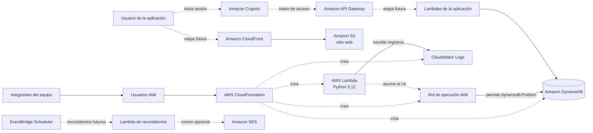

# Finanzas Claras

## Avance de infraestructura en AWS

**Estado:** despliegue inicial realizado y en verificación con evidencias.  
**Región:** US East (N. Virginia), `us-east-1`.  
**Stack observado:** `Proyectoinfrainicial`.  
**Función Lambda observada:** `Proyectoinfrainicial-DemoFunction`.  
**Infraestructura como código:** `template.yaml`.

## Descripción del proyecto

Finanzas Claras es una aplicación para ayudar a las personas a organizar sus finanzas. Permitirá registrar manualmente ingresos, ahorros, gastos, presupuestos, metas de ahorro y fechas de pago. También mostrará resúmenes de gastos por categoría y recordatorios.

En esta etapa la aplicación no se conecta con bancos ni comercios, y no realiza pagos. El objetivo de esta entrega es convertir la primera parte de la arquitectura en recursos de AWS definidos mediante CloudFormation y comprobar una función de demostración.

## Alcance de esta entrega

El archivo `template.yaml` define la infraestructura inicial:

- Una tabla de Amazon DynamoDB para almacenar movimientos.
- Una función AWS Lambda con código de demostración en Python.
- Un rol IAM para los permisos de ejecución de Lambda.
- Un grupo de Amazon CloudWatch Logs para los registros de la función.

La función de demostración guarda un movimiento ficticio en DynamoDB cuando recibe el evento `{"action":"save-demo"}`.

## Arquitectura

Las flechas sólidas representan los recursos de la primera entrega. Las líneas punteadas son servicios planeados para una siguiente etapa y todavía no forman parte del despliegue inicial.



## Componentes AWS: función, configuración y relaciones

| Componente | Función | Configuración en esta entrega | Relación |
|---|---|---|---|
| **AWS CloudFormation** | Crea y administra los recursos descritos como código. | Lee la plantilla `template.yaml` y administra los recursos dentro de un stack. | Crea la tabla, la función, el rol de ejecución y el grupo de logs. |
| **AWS Lambda** | Ejecuta la lógica de demostración para guardar un movimiento de prueba. | Python 3.12, memoria de 128 MB y timeout de 10 segundos. | Asume el rol IAM, obtiene el nombre de la tabla desde una variable de entorno y escribe el movimiento en DynamoDB. |
| **Amazon DynamoDB** | Guarda los movimientos financieros registrados por la aplicación. | Tabla en modo bajo demanda (`PAY_PER_REQUEST`) y cifrado habilitado. Usa `userId` como clave de partición y `transactionId` como clave de ordenamiento. | Lambda inserta el elemento de demostración mediante `dynamodb:PutItem`. |
| **AWS IAM** | Controla qué acciones puede realizar la función. | El rol de ejecución confía en Lambda. La política permite `dynamodb:PutItem` en la tabla del proyecto y escribir registros en CloudWatch Logs. | Lambda asume el rol durante la ejecución; no se guardan claves de acceso en el código. |
| **Amazon CloudWatch Logs** | Conserva los registros de ejecución y errores de Lambda. | Grupo de logs asociado a la función, con retención de siete días. | Lambda envía los registros a CloudWatch para su consulta. |

Los usuarios IAM del equipo permiten trabajar en la cuenta de AWS. Son distintos de Cognito, que se planea usar para las cuentas de los usuarios finales de la aplicación.

## Prueba de demostración

El evento usado para probar la función es:

```json
{
  "action": "save-demo"
}
```

La función guarda un elemento ficticio con estos datos:

- Usuario: `demo-user`
- Identificador del movimiento: `demo-transaction-001`
- Descripción: `Gasto de demostración`
- Categoría: `comida`
- Importe: `150.00`

La prueba se ejecuta desde la consola de Lambda. Esta primera entrega no publica un endpoint de API ni recibe movimientos de usuarios reales.

## Despliegue

1. Iniciar sesión en la consola de AWS con el usuario IAM asignado.
2. Seleccionar la región `us-east-1`.
3. Abrir CloudFormation y crear un stack nuevo usando `template.yaml`.
4. Reconocer la creación de recursos IAM cuando CloudFormation lo solicite durante la revisión.
5. Revisar el estado y los eventos del stack.
6. Abrir la función Lambda y ejecutar el evento de demostración.
7. Revisar el elemento en la tabla de DynamoDB y los registros en CloudWatch Logs.

El estado final del stack y los nombres físicos de la tabla y del rol se pueden consultar en CloudFormation, en las pestañas **Resources** y **Outputs**.

## Evidencias

Las capturas del despliegue se guardan en `evidence/`. Usa estos nombres o actualízalos para que coincidan con los archivos reales:

| Archivo | Evidencia |
|---|---|
| `evidence/01-cloudformation-stack.png` | Nombre del stack y estado final. |
| `evidence/02-cloudformation-resources.png` | Recursos creados por CloudFormation. |
| `evidence/03-cloudformation-outputs.png` | Outputs con los nombres de la función y la tabla. |
| `evidence/04-lambda-test.png` | Resultado exitoso de la prueba de Lambda. |
| `evidence/05-dynamodb-item.png` | Movimiento de demostración guardado en DynamoDB. |
| `evidence/06-iam-role-permissions.png` | Permisos del rol de ejecución asociados a Lambda. |
| `evidence/07-lambda-metrics.png` | Métricas de Lambda después de invocarla. |
| `evidence/08-cloudwatch-logs.png` | Registros de la ejecución de Lambda. |

## Servicios planeados para una siguiente etapa

Estos servicios pertenecen a la arquitectura futura. No se consideran desplegados hasta que se agreguen a `template.yaml` y se comprueben en AWS:

- **Amazon S3 y CloudFront:** alojar y distribuir la interfaz web.
- **Amazon Cognito:** autenticar a los usuarios finales.
- **Amazon API Gateway:** recibir solicitudes de la aplicación y dirigirlas al backend.
- **Más funciones Lambda:** gestionar perfil, movimientos, presupuestos, metas, tarjetas y reportes.
- **EventBridge Scheduler:** iniciar revisiones programadas de pagos próximos.
- **Amazon SES:** enviar recordatorios por correo, si el equipo implementa ese canal.

