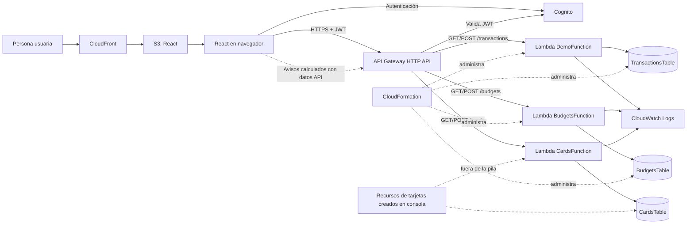

# Finanzas Claras — estado de infraestructura

**Verificación:** 11 de noviembre de 2026 · **Región:** `us-east-1` · **Pila:** `Proyectoinfrainicial` (`UPDATE_COMPLETE`)

## Arquitectura desplegada

El frontend React estático se publica en S3 y CloudFront. Cognito administra el inicio de sesión. API Gateway HTTP API valida el JWT y expone seis rutas protegidas. Tres Lambdas manejan movimientos, presupuestos y tarjetas; cada una consulta o escribe su propia tabla DynamoDB bajo demanda. CloudWatch recibe los logs de ejecución.

Consulta el código Mermaid fuente en `architecture.mmd`.

## Componentes principales

| Componente | Función y configuración | Relación |
|---|---|---|
| Amazon Cognito | Registro, confirmación e inicio de sesión; entrega JWT al navegador. | API Gateway usa el autorizador JWT de este User Pool. |
| API Gateway HTTP API | Seis rutas: GET/POST para `/transactions`, `/budgets` y `/cards`; todas con JWT. | Integra cada dominio con su Lambda. |
| Lambda de movimientos | Python 3.12, handler `index.handler`; crea y consulta ingresos/gastos. | Usa `TransactionsTable` y su rol de ejecución. |
| Lambda de presupuestos | Python 3.12, handler `index.handler`; crea/actualiza límites y los consulta por mes. | Usa `BudgetsTable`; definida y administrada por CloudFormation. |
| Lambda de tarjetas | Python 3.12, handler `lambda_function.handler`; guarda y consulta nombre, emisor, límite, saldo y días de corte/pago. | Usa `CardsTable`; recursos creados manualmente, protegidos por JWT y asociados al autorizador. |
| DynamoDB | Tres tablas con claves compuestas por usuario y entidad; modo `PAY_PER_REQUEST`. | Cada Lambda usa solo su tabla. |
| S3 y CloudFront | Entregan la aplicación React estática mediante HTTPS y caché CDN. | El navegador se comunica con Cognito y API Gateway. |
| CloudWatch Logs | Registra invocaciones y errores de las funciones. | Cada Lambda produce su propio grupo de logs. |
| CloudFormation | Pila principal con 21 recursos administrados, incluidos movimientos y presupuestos. | La infraestructura de tarjetas está fuera de esta pila. |

## Rutas y pruebas comprobadas

| Ruta o flujo | Resultado |
|---|---|
| `POST /transactions` y `GET /transactions` | Prueba desde la aplicación: creación y consulta de movimientos. También hubo una prueba sin firma rechazada con `403`. |
| `POST /budgets` y `GET /budgets` | Recursos desplegados con CloudFormation; el límite guardado desde la aplicación sigue visible al recargar. |
| `POST /cards` y `GET /cards` | Prueba de Lambda: `201` al guardar y `200` al consultar. En la aplicación, la tarjeta persiste tras recargar. |
| Avisos | La app muestra el recordatorio de pago próximo. Los avisos se calculan dentro del frontend a partir de tarjetas, presupuestos y movimientos. |
| Frontend | `npm run lint` pasó; compilación de producción generada y publicada en S3. |

## Problemas encontrados y corregidos

1. El primer POST de tarjeta usó `cardName`; la Lambda requería `name`. Se corrigió el cuerpo y el POST respondió `201`.
2. El evento de prueba usó `dueDay`; la Lambda requería `paymentDueDay`. Se corrigió y el POST respondió `201`.
3. La tabla de tarjetas no aparecía en la variable de entorno correcta de Lambda. Se estableció `CARDS_TABLE_NAME` con el nombre real y la consulta devolvió la tarjeta guardada.

## Alcance y límites

- Los gastos, ingresos, presupuestos y saldos de tarjeta se ingresan manualmente.
- No se guardan PAN ni CVV y no hay conexión bancaria.
- Avisos solo se muestran dentro de la app al abrir/refrescar esa sección; no hay EventBridge Scheduler ni envío por correo/SMS/push.
- Metas de ahorro independientes y consejos personalizados todavía no están implementados.
- Los recursos de tarjetas deben documentarse y añadirse/importarse a IaC para que CloudFormation reproduzca toda la cuenta.

## Archivos IaC

`template.yaml` administra la pila de movimientos y presupuestos. Antes de desplegar cambios, revisa el change set y confirma que no proponga reemplazar `TransactionsTable`, Cognito o la API sin intención. El archivo no incluye todavía los recursos manuales de tarjetas.

Las capturas adicionales de CloudFormation, las pruebas UI de presupuestos/tarjetas y la pantalla Avisos deben guardarse en `evidence/capturas/` antes de entregar el repositorio.
