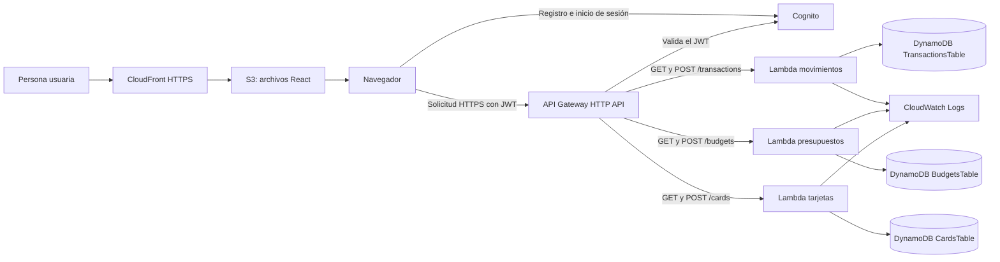

# Finanzas Claras

Aplicación web académica para registrar información financiera manual y consultar un resumen, presupuestos y datos de tarjetas. No se conecta a bancos, no mueve dinero y no guarda números de tarjeta ni CVV.

## Estado desplegado

Verificado el 12 de noviembre de 2026 en AWS `us-east-1`:

- Pila `Proyectoinfrainicial`: `UPDATE_COMPLETE`, 31 recursos.
- Tres funciones Lambda Python 3.12.
- Seis rutas de API Gateway, todas protegidas con JWT de Amazon Cognito.
- Tres tablas DynamoDB usadas por la aplicación, con capacidad `PAY_PER_REQUEST`.
- El frontend React se publica en S3 y se sirve con CloudFront, por separado de la pila CloudFormation.
- `Proyecto_Infra/template.yaml`: 440 líneas.

El repositorio contiene el estado del backend y la configuración desplegada. AWS conserva una tabla antigua `GoalsTable` separada de la pila por una regla `Retain`; el sitio actual no la usa. Por eso la cuenta muestra cuatro tablas, aunque el flujo vigente usa tres.

## Funcionalidades actuales

- Crear cuenta, confirmar correo, iniciar sesión y cerrar sesión.
- Registrar ingresos y gastos actuales o planeados.
- Consultar el resumen y hasta los últimos 100 movimientos.
- Crear o actualizar presupuestos mensuales por categoría.
- Registrar o actualizar datos manuales de tarjetas: nombre, emisor, límite, saldo y fechas de corte y pago.

Las metas, los reportes mensuales y los avisos automáticos se retiraron. Tampoco hay conexión bancaria, pagos ni cargos automáticos.

## Flujo



El diagrama detallado está en [`Proyecto_Infra/architecture.mmd`](Proyecto_Infra/architecture.mmd). La plantilla CloudFormation administra el backend y Cognito; el bucket S3 del sitio y CloudFront se mantienen por separado.

## API

| Método y ruta | Función | Uso |
|---|---|---|
| `GET /transactions` | `DemoFunction` | Consultar movimientos propios |
| `POST /transactions` | `DemoFunction` | Guardar un ingreso o gasto |
| `GET /budgets` | `BudgetsFunction` | Consultar presupuestos |
| `POST /budgets` | `BudgetsFunction` | Crear o actualizar un presupuesto |
| `GET /cards` | `CardsFunction` | Consultar tarjetas propias |
| `POST /cards` | `CardsFunction` | Crear o actualizar una tarjeta |

- **Sitio:** https://d32bc7tq7qvtgu.cloudfront.net
- **API:** https://3wsywaa6oh.execute-api.us-east-1.amazonaws.com

Cada función obtiene el identificador de usuario de los claims del JWT validado y consulta su propia tabla. El frontend no puede elegir un `userId` distinto.

## Verificaciones recientes

- `npm run lint` y `npm run build` terminan correctamente.
- Las páginas principales publicadas responden `200`.
- Las seis rutas API rechazan solicitudes sin token con `401`, como se espera.
- La pila, las rutas, las funciones, las tablas y CloudFront se comprobaron en AWS.
- Las funciones de datos se probaron por separado con datos sintéticos y se limpiaron. No se probó en esta revisión una contraseña real de usuario.

El inventario actualizado está en [`Proyecto_Infra/evidence/15-post-trim-verification.json`](Proyecto_Infra/evidence/15-post-trim-verification.json). Las evidencias anteriores a esta verificación son históricas y describen versiones previas.

## Desarrollo local

Se requiere Node.js y npm.

```powershell
Set-Location frontend
npm ci
Copy-Item .env.example .env.local
npm run dev
```

Para comprobar el frontend:

```powershell
npm run lint
npm run build
```

## Empaquetar funciones antes de actualizar AWS

Desde la raíz del repositorio, usa un bucket privado de artefactos en `us-east-1`:

```powershell
$bucketArtefactos = "NOMBRE_DE_BUCKET_PRIVADO_EN_US_EAST_1"
aws cloudformation package --template-file Proyecto_Infra/template.yaml --s3-bucket $bucketArtefactos --s3-prefix finanzas-claras/lambda --output-template-file Proyecto_Infra/template.packaged.yaml --region us-east-1
```

Carga la plantilla empaquetada en CloudFormation, revisa el change set antes de ejecutarlo y usa `CAPABILITY_NAMED_IAM` si AWS lo solicita. No uses el bucket público del sitio para los paquetes de Lambda.

## Límites que conviene tener presentes

- Es una demostración académica con captura manual, no un servicio bancario.
- CORS de la API permite cualquier origen (`*`); se debe restringir al dominio del sitio antes de abrir la app al público.
- Los datos de la cuenta AWS y el tráfico generan costos según el uso. Revísalos en AWS Billing.
- `GoalsTable` se conserva fuera de CloudFormation. No la borres sin confirmar que sus datos ya no se necesitan.
