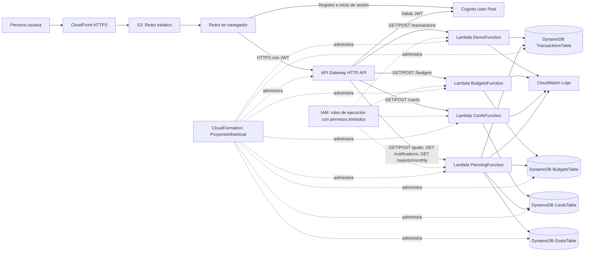

# Finanzas Claras

Aplicación web serverless para registrar ingresos y gastos, organizar presupuestos, metas y tarjetas, y consultar un resumen de salud financiera. Los datos se capturan manualmente. La aplicación no se conecta a bancos y no solicita ni almacena números de tarjeta o CVV.

**Estado verificado:** 11 de noviembre de 2026
**Región:** `us-east-1`
**Pila CloudFormation:** `Proyectoinfrainicial` (`UPDATE_COMPLETE`, 43 recursos)

## Funcionalidades

- Registro, confirmación, inicio y cierre de sesión con Amazon Cognito.
- Dashboard con balance, movimientos recientes y desglose de gastos.
- Ingresos y gastos reales o planeados, guardados por usuario.
- Presupuestos mensuales por categoría.
- Metas de ahorro.
- Tarjetas registradas manualmente con emisor, límite, saldo y días de corte y pago.
- Avisos dentro de la aplicación para pagos próximos, presupuestos cerca del límite, gastos planeados y metas próximas.
- Reporte mensual con ingresos, gastos, categorías, presupuestos y recomendaciones sencillas.

Los avisos se calculan cuando la aplicación consulta `/notifications`; no se envían por correo, SMS ni notificaciones push. No hay conexión bancaria ni cargos/pagos automáticos.

## Arquitectura



El diagrama Mermaid editable está en [`Proyecto_Infra/architecture.mmd`](Proyecto_Infra/architecture.mmd). La plantilla administra Cognito, API Gateway, las cuatro Lambdas, sus permisos/roles, grupos de logs y las cuatro tablas DynamoDB. El bucket de archivos estáticos, la distribución de CloudFront y los objetos del frontend se configuraron y publican por separado.

## API

Las diez rutas requieren el autorizador JWT de Cognito. La Lambda obtiene el identificador de usuario del claim validado `sub`; no confía en un `userId` enviado por el navegador.

| Método y ruta | Lambda | Uso |
|---|---|---|
| `GET /transactions` | `DemoFunction` | Consultar movimientos propios |
| `POST /transactions` | `DemoFunction` | Registrar ingreso o gasto |
| `GET /budgets` | `BudgetsFunction` | Consultar presupuestos del mes |
| `POST /budgets` | `BudgetsFunction` | Crear o actualizar un presupuesto |
| `GET /cards` | `CardsFunction` | Consultar tarjetas propias |
| `POST /cards` | `CardsFunction` | Crear o actualizar una tarjeta |
| `GET /goals` | `PlanningFunction` | Consultar metas propias |
| `POST /goals` | `PlanningFunction` | Crear o actualizar una meta |
| `GET /notifications` | `PlanningFunction` | Calcular avisos dentro de la app |
| `GET /reports/monthly` | `PlanningFunction` | Generar el reporte de un mes |

**API base:** `https://3wsywaa6oh.execute-api.us-east-1.amazonaws.com`
**Sitio:** [https://d32bc7tq7qvtgu.cloudfront.net](https://d32bc7tq7qvtgu.cloudfront.net)

## Datos y seguridad

| Tabla | Clave de partición | Clave de ordenación | Modo |
|---|---|---|---|
| `TransactionsTable` | `userId` | `transactionId` | `PAY_PER_REQUEST` |
| `BudgetsTable` | `userId` | `budgetKey` | `PAY_PER_REQUEST` |
| `CardsTable` | `userId` | `cardId` | `PAY_PER_REQUEST` |
| `GoalsTable` | `userId` | `goalId` | `PAY_PER_REQUEST` |

- Cognito autentica a las personas usuarias; API Gateway valida sus JWT antes de ejecutar una ruta.
- Cada Lambda usa un rol IAM separado y limitado a las tablas y logs que necesita.
- Los grupos de logs de las funciones tienen retención configurada de siete días.
- No se usan EC2 ni NAT Gateway.
- Los identificadores públicos de Cognito y la URL de API pueden estar en la configuración del frontend; no incluyas claves IAM, contraseñas, tokens ni secretos.

## Verificación del despliegue

- La pila terminó en `UPDATE_COMPLETE` con 43 recursos. Las cuatro Lambdas están `Active` y con última actualización `Successful`.
- CloudFront está `Deployed`; `index.html` y los dos recursos compilados actuales existen en S3 y la última invalidación registrada está `Completed`.
- API Gateway tiene diez rutas con `AuthorizationType: JWT` y el autorizador de Cognito configurado.
- La función de tarjetas se probó con un evento de lectura controlado: `GET /cards` devolvió `200`, sin error de ejecución, y consultó el registro de prueba asociado al usuario sintético `lambda-read-test`.
- El grupo de logs de tarjetas confirma la ejecución; CloudFormation conserva la función, tabla, rol, política, integración y rutas dentro de la pila.
- Las pruebas de interfaz previas del equipo comprobaron el inicio de sesión, registro y consulta de movimientos, persistencia de tarjetas y visualización de avisos. Las capturas disponibles están en `Proyecto_Infra/evidence/capturas/`.
- El inventario más reciente de AWS y las pruebas de humo de la Lambda de tarjetas están guardados en [`14-final-deployment-verification.json`](Proyecto_Infra/evidence/14-final-deployment-verification.json).

El archivo `Proyecto_Infra/evidence/09-api-e2e-results.json` conserva una prueba anterior de transacciones firmada con IAM, de una etapa previa. La configuración actual usa JWT de Cognito. Las capturas `Proyecto_Infra/evidence/capturas/` documentan la primera pila y no reflejan los 43 recursos actuales; no las presentes como capturas del despliegue final.

## Problemas técnicos detectados y resueltos

1. **Los recursos de tarjetas estaban fuera de CloudFormation.** Se adoptaron mediante un change set de importación, preservando los recursos y los datos existentes; ahora forman parte de la pila.
2. **La Lambda inline buscaba un módulo que no existía.** CloudWatch registró `Runtime.ImportModuleError` porque el handler seguía usando `lambda_function.handler`. Se alineó el handler con `index.handler`, el archivo generado para el código inline, y la lectura posterior devolvió `200`.
3. **Una plantilla intermedia proponía cambios en la función de planeación.** Se mantuvieron las referencias originales de esa función; el change set final se limitó a tarjetas y no propuso reemplazos.

## Ejecutar localmente

Se requiere Node.js y npm.

```powershell
Set-Location frontend
npm ci
Copy-Item .env.example .env.local
npm run dev
```

Completa `frontend/.env.local` con los valores de desarrollo del equipo y abre la URL local que muestre Vite. Esos valores identifican recursos públicos; nunca pongas credenciales IAM en el frontend.

## Compilar y publicar el frontend

```powershell
Set-Location frontend
npm ci
npm run lint
npm run build
```

Carga **el contenido** de `frontend/dist/` al bucket S3 del sitio, sobrescribiendo los archivos previos. Después crea una invalidación `/*` en la distribución CloudFront para retirar archivos antiguos de caché.

## Mantener y actualizar infraestructura

Desde la raíz del repositorio, primero sincroniza los cuatro handlers con sus bloques `ZipFile` en CloudFormation:

```powershell
node backend/scripts/sync-lambda-source.mjs --write
node backend/scripts/sync-lambda-source.mjs
```

En AWS Console, abre **CloudFormation → Stacks → `Proyectoinfrainicial` → Update**; carga `Proyecto_Infra/template.yaml`, incluye `CAPABILITY_NAMED_IAM`, crea un change set y revisa sus cambios antes de ejecutarlo. Detén la actualización si propone reemplazar una tabla con datos, el User Pool o la API sin que sea intencional. La plantilla incluye políticas de retención para proteger los recursos de tarjetas.

## Costos y alcance

La solución prioriza servicios bajo demanda: Lambda, DynamoDB `PAY_PER_REQUEST`, S3 y CloudFront. No se promete costo cero: los cargos dependen del uso, región, tráfico, almacenamiento y límites gratuitos vigentes. Revisa AWS Billing después de desplegar.

Es una aplicación académica de demostración; utiliza datos de prueba y no almacena credenciales bancarias ni ejecuta pagos.
