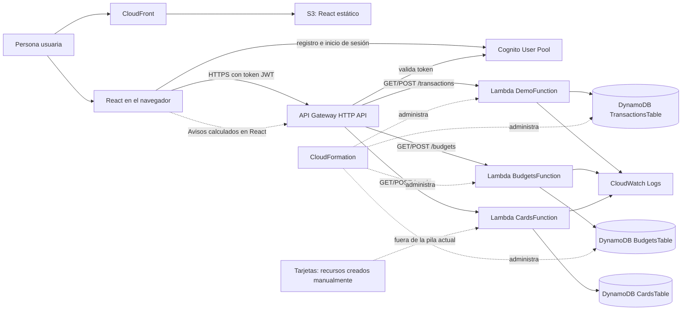

# Finanzas Claras

Aplicación web serverless para que una persona registre ingresos y gastos, defina presupuestos por categoría, organice los datos de sus tarjetas y consulte avisos financieros básicos. Se usan datos ingresados manualmente; la aplicación no se conecta a bancos ni guarda números de tarjeta o CVV.

**Estado verificado:** 11 de noviembre de 2026 · **Región:** `us-east-1` · **Pila principal:** `Proyectoinfrainicial`

## Estado funcional

- Registro, confirmación e inicio de sesión con Amazon Cognito.
- Aplicación React publicada en S3 y distribuida mediante CloudFront.
- Movimientos: ingresos y gastos con consulta y escritura en DynamoDB.
- Presupuestos mensuales por categoría: consulta, creación/actualización y comparación con los gastos reales.
- Tarjetas: almacenamiento manual del emisor, límite, saldo y días de corte/pago.
- Avisos dentro de la aplicación para fechas de pago cercanas, presupuestos usados al 80% o más y gastos planeados próximos.
- El panel presenta balance, movimientos recientes y gastos por categoría.

Los avisos se calculan al abrir la sección y no se envían por correo, SMS ni notificaciones push.

## Arquitectura actual



Las seis rutas de la API requieren el autorizador JWT de Cognito. Las tres tablas usan `PAY_PER_REQUEST`. La pila CloudFormation está en `UPDATE_COMPLETE` y administra los recursos de movimientos y presupuestos. La Lambda, tabla, rol e integración de tarjetas fueron creados manualmente en la consola y todavía no pertenecen a esa pila.

## Pruebas realizadas

- Movimientos: `POST` devolvió `201`, `GET` devolvió `200` con los movimientos y una solicitud sin autorización fue rechazada con `403`.
- Tarjetas: Lambda `POST` devolvió `201`; `GET` devolvió `200` y un elemento. La tarjeta de prueba también se guardó desde la aplicación, persistió tras recargar y produjo un aviso de pago próximo.
- Presupuestos: la función, tabla y rutas se desplegaron con CloudFormation. Se guardó un límite desde la aplicación y se comprobó que continuaba visible tras recargar.
- Frontend: `npm run lint` pasó y la compilación de producción se generó correctamente.

Las capturas que tome el equipo deben guardarse en `Proyecto_Infra/evidence/capturas/`, con nombres que describan cada pantalla. No incluyas contraseñas, claves IAM, tokens ni datos financieros reales.

## Límites de esta entrega

- No hay integración bancaria.
- Los avisos solo aparecen dentro de la app; no existe envío automático de correo/SMS/push ni ejecución programada.
- Aún no se implementan metas de ahorro independientes, consejos personalizados ni reportes mensuales enviados/exportables.
- Los recursos de tarjetas están fuera de CloudFormation; la plantilla no reproduce todavía toda la infraestructura desplegada.

## Repositorio

```text
frontend/                    React, autenticación y cliente HTTP
backend/src/transactions/    Lambda de movimientos
backend/src/budgets/         Lambda de presupuestos
backend/src/cards/           Lambda de tarjetas (configurada manualmente)
Proyecto_Infra/template.yaml CloudFormation para movimientos y presupuestos
Proyecto_Infra/architecture.mmd Diagrama de arquitectura
```

## Ejecutar y compilar el frontend

```powershell
Set-Location frontend
npm install
npm run dev
```

Para generar los archivos estáticos que se publican en S3:

```powershell
npm run lint
npm run build
```

La configuración local `frontend/.env.local` debe contener los identificadores públicos de Cognito y el endpoint API del equipo. No agregues credenciales IAM, contraseñas ni tokens a esa configuración o a Git.

## Infraestructura como código

`Proyecto_Infra/template.yaml` define la pila de movimientos y presupuestos. El archivo fuente `backend/src/budgets/handler.py` se sincroniza con su bloque inline de CloudFormation mediante `node backend/scripts/sync-lambda-source.mjs --write`. Antes de actualizar la pila, crea y revisa un change set; detén el despliegue si propone reemplazar la tabla de movimientos, el User Pool o la API sin que sea intencional.

Los recursos de tarjetas se desplegaron desde la consola y están documentados en `backend/README.md`. Para reproducir toda la infraestructura en un entorno nuevo, primero hay que añadir/importar esos recursos en IaC y verificar sus permisos.

## Costos

No se utiliza EC2 ni NAT Gateway. Lambda, DynamoDB bajo demanda, S3 y CloudFront cobran según uso y región; el costo gratuito depende de los límites y condiciones vigentes de la cuenta. Evita crear recursos adicionales solo para aumentar el número de servicios.
