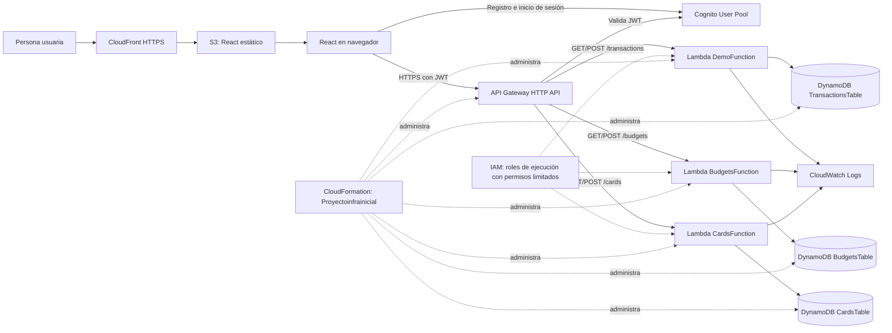

# Finanzas Claras

Aplicación web serverless para registrar ingresos y gastos, organizar presupuestos y tarjetas, y consultar un resumen financiero. Los datos se capturan manualmente. La aplicación no se conecta a bancos y no solicita ni almacena números de tarjeta o CVV.

**Último despliegue comprobado:** 11 de noviembre de 2026 · `us-east-1` · `Proyectoinfrainicial` (`UPDATE_COMPLETE`, 43 recursos). Ese despliegue todavía corresponde a la versión anterior, con 4 Lambdas y 10 rutas; el recorte descrito aquí aún requiere actualizar AWS.

## Funcionalidades

- Registro, confirmación, inicio y cierre de sesión con Amazon Cognito.
- Dashboard con balance, movimientos recientes y desglose de gastos.
- Ingresos y gastos reales o planeados, guardados por usuario.
- Presupuestos mensuales por categoría.
- Tarjetas registradas manualmente con emisor, límite, saldo y días de corte y pago.

Se retiraron del alcance las metas, los reportes mensuales y los avisos. No hay conexión bancaria ni cargos/pagos automáticos.

## Arquitectura



El diagrama Mermaid editable está en [`Proyecto_Infra/architecture.mmd`](Proyecto_Infra/architecture.mmd). La plantilla reducida administra Cognito, API Gateway, tres Lambdas, sus roles/permisos, grupos de logs y tres tablas DynamoDB. El bucket de archivos estáticos, la distribución de CloudFront y los objetos del frontend se publican por separado.

## API

Las seis rutas requieren el autorizador JWT de Cognito. La Lambda obtiene el identificador de usuario del claim validado `sub`; no confía en un `userId` enviado por el navegador.

| Método y ruta | Lambda | Uso |
|---|---|---|
| `GET /transactions` | `DemoFunction` | Consultar movimientos propios |
| `POST /transactions` | `DemoFunction` | Registrar ingreso o gasto |
| `GET /budgets` | `BudgetsFunction` | Consultar presupuestos del mes |
| `POST /budgets` | `BudgetsFunction` | Crear o actualizar un presupuesto |
| `GET /cards` | `CardsFunction` | Consultar tarjetas propias |
| `POST /cards` | `CardsFunction` | Crear o actualizar una tarjeta |

**API base:** `https://3wsywaa6oh.execute-api.us-east-1.amazonaws.com`
**Sitio:** [https://d32bc7tq7qvtgu.cloudfront.net](https://d32bc7tq7qvtgu.cloudfront.net)

## Datos y seguridad

| Tabla | Clave de partición | Clave de ordenación | Modo |
|---|---|---|---|
| `TransactionsTable` | `userId` | `transactionId` | `PAY_PER_REQUEST` |
| `BudgetsTable` | `userId` | `budgetKey` | `PAY_PER_REQUEST` |
| `CardsTable` | `userId` | `cardId` | `PAY_PER_REQUEST` |

- Cognito autentica a las personas usuarias; API Gateway valida sus JWT antes de ejecutar una ruta.
- Cada Lambda usa un rol IAM separado y limitado a las tablas y logs que necesita.
- Los grupos de logs de las funciones tienen retención configurada de siete días.
- No se usan EC2 ni NAT Gateway.
- Los identificadores públicos de Cognito y la URL de API pueden estar en la configuración del frontend; no incluyas claves IAM, contraseñas, tokens ni secretos.

## Verificación del despliegue

- La evidencia del 11 de noviembre corresponde a la versión previa: 43 recursos, cuatro Lambdas y diez rutas. Después del recorte se esperan 31 recursos, tres Lambdas y seis rutas; hace falta desplegar y capturar evidencia nueva.
- El último estado de CloudFront registrado (`Deployed`) corresponde al frontend anterior. Después de publicar la versión reducida, hay que volver a verificar la distribución.
- La función de tarjetas se probó con un evento de lectura controlado: `GET /cards` devolvió `200`, sin error de ejecución, y consultó el registro de prueba asociado al usuario sintético `lambda-read-test`.
- El grupo de logs de tarjetas confirma la ejecución; CloudFormation conserva la función, tabla, rol, política, integración y rutas dentro de la pila.
- Las capturas y el inventario JSON guardados en `Proyecto_Infra/evidence/` son evidencia histórica del despliegue anterior; no prueban la versión reducida.

El archivo `Proyecto_Infra/evidence/09-api-e2e-results.json` conserva una prueba anterior de transacciones firmada con IAM, de una etapa previa. La configuración actual usa JWT de Cognito. Las capturas `Proyecto_Infra/evidence/capturas/` documentan la primera pila y no reflejan los 43 recursos actuales; no las presentes como capturas del despliegue final.

## Problemas técnicos detectados y resueltos

1. **Los recursos de tarjetas estaban fuera de CloudFormation.** Se adoptaron mediante un change set de importación, preservando los recursos y los datos existentes; ahora forman parte de la pila.
2. **El empaquetado de las Lambdas queda explícito.** Las funciones usan `handler.handler` dentro de un ZIP generado desde su carpeta de código. La plantilla fuente se debe procesar con `aws cloudformation package` antes de cargarla en AWS.
3. **Reducción de alcance:** la plantilla ya no declara el servicio de planeación ni sus cuatro rutas. La tabla `GoalsTable` tenía `DeletionPolicy: Retain`, por lo que al actualizar la pila AWS la conservará fuera de CloudFormation y no borrará sus datos.

## Ejecutar localmente

Se requiere Node.js y npm.

```powershell
Set-Location frontend
npm ci
Copy-Item .env.example .env.local
npm run dev
```

Completa `frontend/.env.local` con los valores de desarrollo del equipo y abre la URL local que muestre Vite. Esos valores identifican recursos públicos; nunca pongas credenciales IAM en el frontend.

## Compilar y publicar el frontend

```powershell
Set-Location frontend
npm ci
npm run lint
npm run build
```

Carga **el contenido** de `frontend/dist/` al bucket S3 del sitio, sobrescribiendo los archivos previos. Después crea una invalidación `/*` en la distribución CloudFront para retirar archivos antiguos de caché.

## Mantener y actualizar infraestructura

Desde la raíz del repositorio, genera la plantilla lista para desplegar. `aws cloudformation package` crea los ZIPs desde las carpetas locales de las Lambdas y los sube a un bucket privado existente en `us-east-1`:

```powershell
$bucketArtefactos = "NOMBRE_DE_BUCKET_PRIVADO_EN_US_EAST_1"
aws cloudformation package --template-file Proyecto_Infra/template.yaml --s3-bucket $bucketArtefactos --s3-prefix finanzas-claras/lambda --output-template-file Proyecto_Infra/template.packaged.yaml --region us-east-1
```

La plantilla empaquetada contiene las ubicaciones S3 de los ZIPs; no cargues `template.yaml` sin empaquetar. En AWS Console, abre **CloudFormation → Stacks → `Proyectoinfrainicial` → Update**, carga `Proyecto_Infra/template.packaged.yaml`, crea un change set y revisa las eliminaciones antes de ejecutarlo. Se requiere `CAPABILITY_NAMED_IAM`. No uses el bucket público del sitio para los paquetes de Lambda.

La tabla `GoalsTable` tiene `DeletionPolicy: Retain`: al retirar su definición, AWS la conservará y la separará de la pila. Si después se quiere borrar esa tabla, primero confirma que sus datos ya no se necesitan.

## Costos y alcance

La solución prioriza servicios bajo demanda: Lambda, DynamoDB `PAY_PER_REQUEST`, S3 y CloudFront. No se promete costo cero: los cargos dependen del uso, región, tráfico, almacenamiento y límites gratuitos vigentes. Revisa AWS Billing después de desplegar.

Es una aplicación académica de demostración; utiliza datos de prueba y no almacena credenciales bancarias ni ejecuta pagos.
