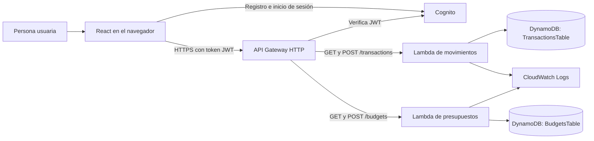

# Finanzas Claras

Aplicación web para registrar ingresos y gastos, consultar un balance básico y organizar límites mensuales por categoría. La arquitectura usa servicios serverless de AWS para mantenerla sencilla y evitar servidores encendidos.

## Estado del prototipo

- Registro, confirmación e inicio de sesión con Amazon Cognito.
- Registro y consulta de movimientos con API Gateway, Lambda y DynamoDB; el equipo comprobó el flujo desde la interfaz.
- Módulo de presupuestos implementado en código y en la plantilla de CloudFormation; falta desplegar la actualización de la pila y probar sus endpoints en AWS.
- Tarjetas y avisos son secciones visuales para trabajo posterior; aún no guardan información ni envían notificaciones.

## Arquitectura



## Estructura del repositorio

```text
frontend/                 Interfaz React, autenticación y cliente HTTP
backend/src/              Código Python ejecutado por Lambdas
backend/scripts/           Sincronizador de fuentes Lambda con CloudFormation
Proyecto_Infra/template.yaml  Recursos AWS, rutas, roles y permisos
```

El cliente HTTP está en el frontend porque corre en el navegador. La lógica de negocio y acceso a DynamoDB está en las funciones Lambda bajo `backend/`. La plantilla describe los recursos que CloudFormation despliega.

## Ejecutar el frontend

```powershell
cd frontend
npm install
Copy-Item .env.example .env.local
npm run dev
```

Revisa que `.env.local` tenga los identificadores y el endpoint correspondientes a la pila del equipo. Ese archivo está excluido de Git. Nunca agregues claves de acceso IAM ni contraseñas al frontend o al repositorio.

## Mantener y desplegar el código Lambda

Edita las funciones en `backend/src/`. Antes de subir la plantilla a CloudFormation, ejecuta desde la raíz del repositorio:

```powershell
node backend/scripts/sync-lambda-source.mjs --write
node backend/scripts/sync-lambda-source.mjs
```

El primer comando actualiza los bloques de código inline en `Proyecto_Infra/template.yaml`; el segundo confirma que las fuentes y la plantilla coinciden. Después revisa el conjunto de cambios de CloudFormation antes de aplicar la actualización. Esta actualización de presupuestos añade una tabla nueva con política de retención y una Lambda independiente; no ha sido desplegada todavía.

## Comprobaciones locales

```powershell
cd frontend
npm run lint
npm run build
```

Los comandos anteriores validan la interfaz. Las pruebas reales de Cognito, API Gateway y DynamoDB deben realizarse en el entorno AWS del equipo después del despliegue.
